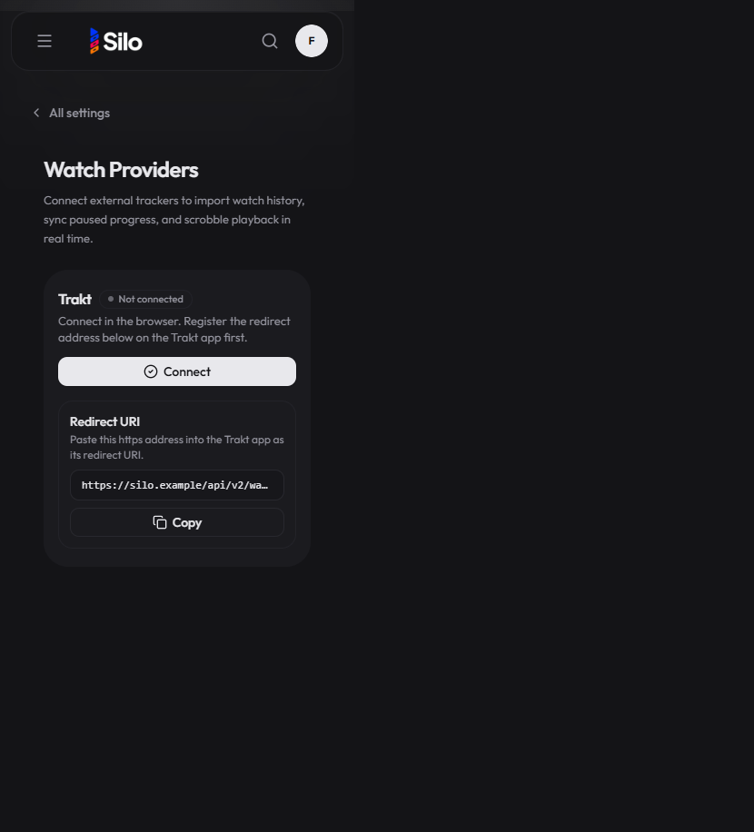

## Steps

1. Open Settings → Watch Providers on a build that includes authorization-code support.
2. Confirm Trakt shows browser Connect copy and a Redirect URI box.
3. Check the same page at phone width.

## Captures

Hostname and profile identifiers were redacted in-page before capture (redirect shown as `https://silo.example/...`).

## Results

Before this change, Connect started device-code activation (user code + trakt.tv/activate) with no redirect URI box. That prior build is not running on this deployment, so a live before capture was not available. No Connect recording is attached; the authorize/callback path was verified earlier on this deployment with private hostnames omitted here.
